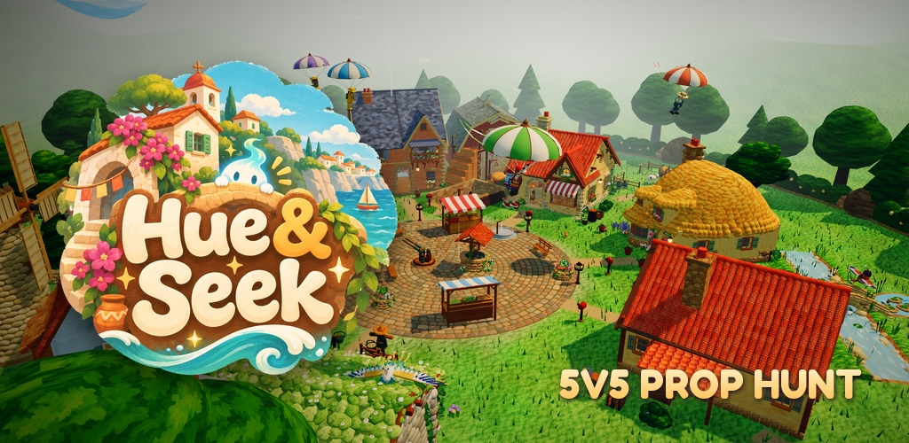
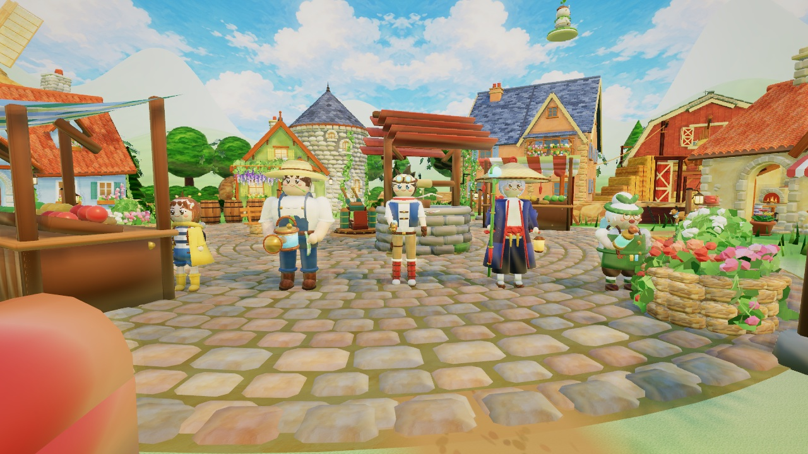
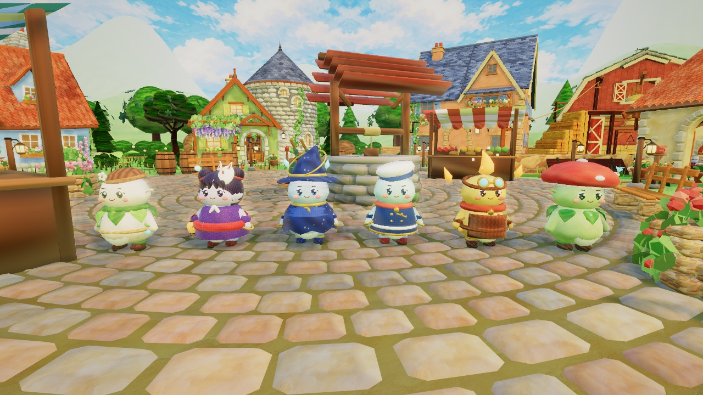
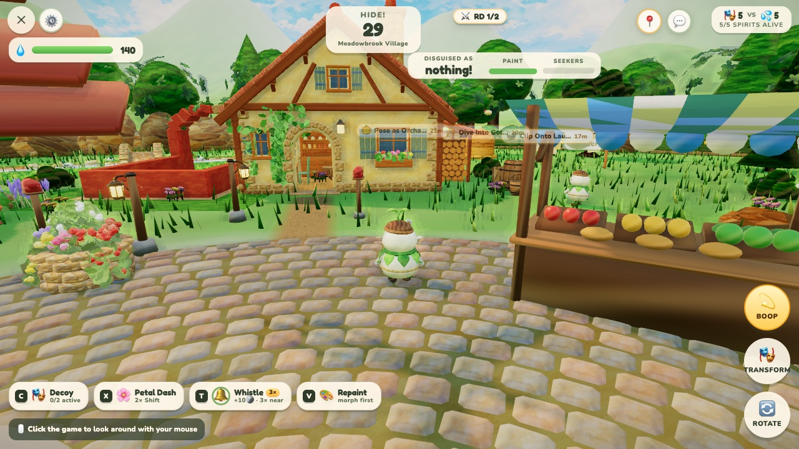
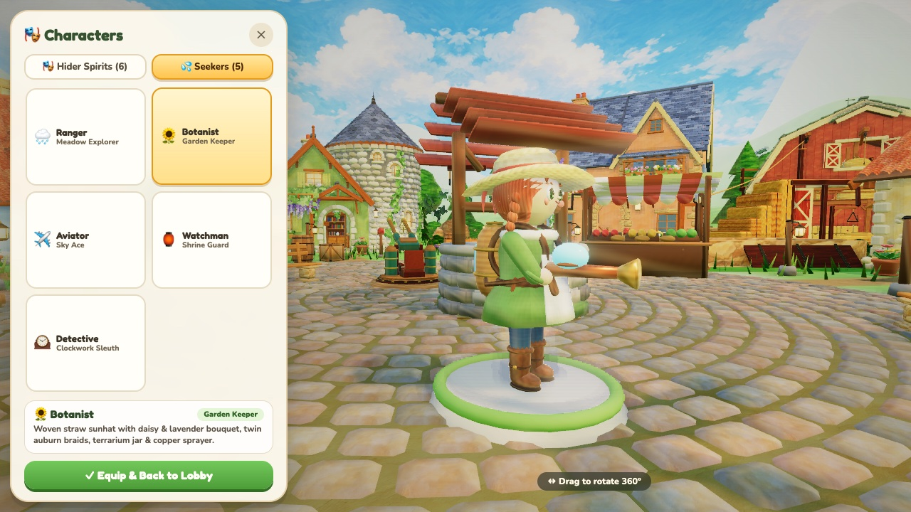

# 🎨 Hue & Seek — 5v5 Storybook Prop Hunt Online

  

  
  
  

**Morph into everyday props, paint yourself to match any surface, or hunt down disguised spirits with 5 elemental water blasters — 100% free with zero ads.**

- 🌐 **Play Live Right Now (Desktop & Mobile Browser):** https://coding-simba.github.io/hue-and-seek/
- 📱 **Get on Google Play (Android):** https://play.google.com/store/apps/details?id=com.hueseek.game
- 📦 **Direct Signed Android APK (v8.4.0):** [GitHub Releases](https://github.com/Coding-Simba/hue-and-seek/releases/latest)

---

## ✨ What Makes Hue & Seek Different

- **🎨 Paint Camouflage:** Dip into paint pots around each map to shift your prop color and vanish seamlessly against walls, roofs, barrels, and market stalls.
- **⚔️ Fast 5v5 Online & Offline Matches:** Jump straight into 5v5 Hide & Seek with global auto-matchmaking — or play seamlessly offline against smart AI squads whenever you have no signal.
- **🗺️ 6 Handcrafted 3D Storybook Worlds:**
  1. **Meadowbrook Village** — sunlit thatched cottages, cobbled plaza & stream
  2. **Lantern Bathhouse** — steaming cedar decks, bridges & glowing paper lanterns
  3. **Sky Ruins** — floating stone sanctuaries above golden clouds
  4. **Seaplane Cove** — turquoise lagoon, docks & coastal cliffs
  5. **Clockwork Town** — turning brass gears, cobbles & cozy rooftops
  6. **Tinyfolk Garden** — oversized mushrooms, dew-drops & secret leaf paths
- **💦 5 Elemental Water Blasters:** Water Soaker, Frost Snare, Bubble Pop, Paint Splat & Thunder Jet.
- **🎭 11 Sculpted 3D Champions + Interactive 3D Character Select:** Pick from **6 Hider Spirits** and **5 distinct Explorer Seekers** with full 360° preview before every match.
- **🚫 Zero Ads · Zero Pay-to-Win:** Every map, champion, and blaster unlocks through playing.

---

## 🎭 Meet the 11 Sculpted Champions (v8.4.0)

### 5 Explorer Seekers
**Mina** (Meadow Scout) · **Bram** (Bramble Giant) · **Kael** (Sky Aviator) · **Sora** (Lantern Guardian) · **Pip** (Clockwork Alchemist)

### 6 Hider Spirits
**Sprout** · **Suds-Star** · **Sky-Crystal** · **Seafoam** · **Ember-Star** · **Clover-Dew**

### Live 5v5 Gameplay & 3D Character Select
| Live 5v5 Prop Hunt | 3D Character Showcase |
| :---: | :---: |
|  |  |

---

## 🕹️ Controls

| Action | Desktop | Mobile (Android / Touch) |
| :--- | :--- | :--- |
| **Move** | `W A S D` / Arrow Keys | Left Virtual Joystick |
| **Look / Aim** | Mouse | Right-Side Drag |
| **Jump** | `Space` | Jump Button |
| **Morph / Spray** | `E` / Left Click | Morph / Fire Button |
| **Paint / Taunt / Dash** | `Q` / `F` / `Shift` | On-Screen Action Buttons |

---

  <a href="https://play.google.com/store/apps/details?id=com.hueseek.game&utm_source=github&utm_medium=readme_footer&utm_campaign=v84_launch"><b>📱 Download Hue & Seek Free on Google Play →</b></a>

